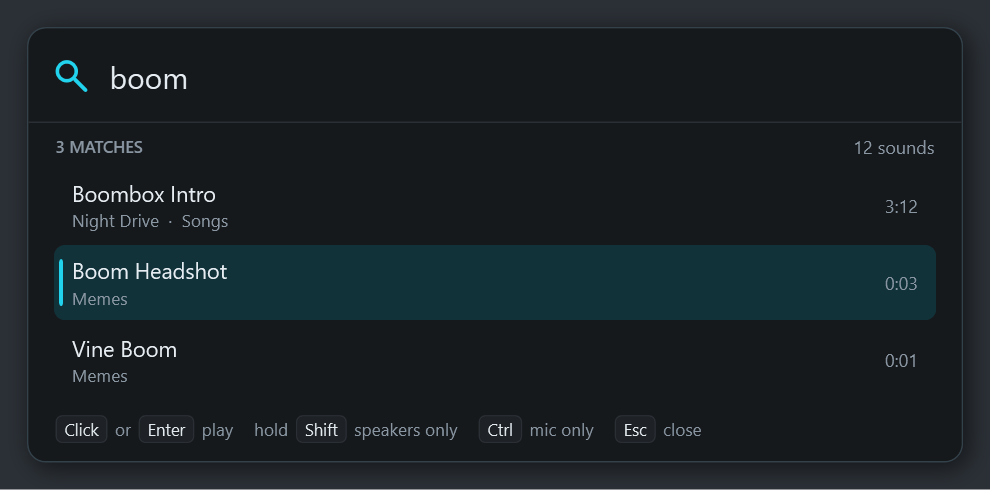
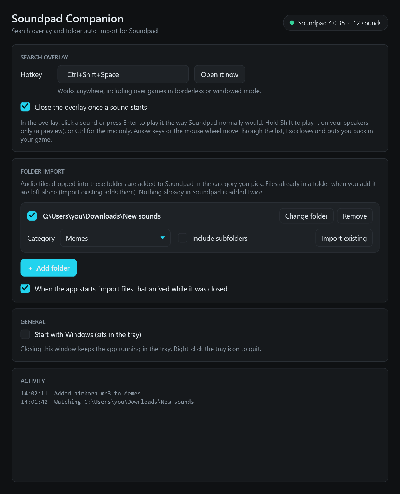

# Soundpad Companion

A small Windows tray app that adds two things to [Soundpad](https://www.leppsoft.com/soundpad/):

- **Quick-search overlay.** Press a hotkey (Ctrl+Shift+Space by default) anywhere, even in a game, type a few letters of a sound and click it or press Enter to play it. Esc puts you straight back where you were.
- **Folder auto-import.** Pick a folder and a Soundpad category. Any audio file you drop into that folder is added to Soundpad in that category.



It does not patch or inject anything into Soundpad. It talks to Soundpad through Soundpad's own [remote control interface](https://www.leppsoft.com/soundpad/rc), the local named pipe `\\.\pipe\sp_remote_control` that Stream Deck and Touch Portal plugins also use. Not affiliated with Leppsoft.

**Status: early (0.1.0).** The overlay has been opened and searched against a real Soundpad 4.0.35. Playing a sound and the folder import are covered by automated tests against a simulated Soundpad, plus read-only checks against a real one, but have not been confirmed on a real install yet. If the first import fails, the Activity list in the settings window shows Soundpad's error code; please open an issue with it.

## Download

Get `SoundpadCompanion.exe` from [Releases](../../releases). It is one standalone file: no installer, no .NET to install, just run it. Windows SmartScreen may warn that it comes from an unknown publisher, because the exe is not code-signed ("More info", then "Run anyway").

Needs Windows 10 or 11 (64-bit) and Soundpad running. Importing needs the full version of Soundpad: the trial refuses to add sounds through remote control. Searching and playing work either way.

## Using it

Run `SoundpadCompanion.exe`. The first time, the settings window opens. After that it sits in the tray: left-click the icon for settings, right-click for the menu (Search sounds, Settings, Quit). Starting it again while it runs just opens the settings window.

### The overlay

| Input | Does |
|---|---|
| type | search titles, file names, artists and category names |
| Up / Down, Page Up / Page Down, mouse wheel | move through the results (the wheel works anywhere on the overlay) |
| click a sound, or Enter | play it the way Soundpad normally would |
| hold Shift while clicking or pressing Enter | play it on your speakers only (a preview nobody else hears) |
| hold Ctrl while clicking or pressing Enter | play it on the mic only |
| Esc | close and give focus back to the game |

A click plays when the button is pressed and released on the same sound, so pressing on one row and letting go on another plays nothing. Typing always stays in the search box, even after clicking.

With an empty search box it lists your most recently played sounds. Every word you type has to match; matches in the title rank first, and sounds you play more often win ties. If nothing matches exactly, it falls back to matching letters in order, so small typos still find things.

The overlay is a normal always-on-top window, so it shows over games running **borderless or windowed**. A game in exclusive fullscreen may minimise when the overlay takes focus; switch the game to borderless if that happens.

### Folder import



- Files already in a folder when you add it are left alone. **Import existing** adds them on purpose.
- Files dropped while the app was closed are imported the next time it starts (you can turn this off).
- Anything already in Soundpad is never added twice, and a sound you delete from Soundpad is not re-added at the next start.
- The category box takes an existing category or a new name; a new name is created in Soundpad. Leave it blank to add to "All sounds" only.
- Files it picks up: mp3, wav, ogg, oga, opus, flac, m4a, aac, wma, aif, aiff, ape, mpc, ac3, mp4, m4v, webm, mkv, mov and avi. Soundpad decides whether it can play a file; if it refuses one, the Activity list says so.

Everything it did is listed under Activity in the settings window.

## Files it keeps

All in `%AppData%\SoundpadCompanion`:

- `config.json`: hotkey, overlay option and import folders
- `import-state.json`: which files the importer has already handled
- `activity.log`: the activity list, trimmed when it passes 1 MB

"Start with Windows" adds a `SoundpadCompanion` value under `HKCU\Software\Microsoft\Windows\CurrentVersion\Run` and removes it when unticked.

## Building

Needs the .NET 10 SDK on Windows.

```
dotnet build
dotnet test
```

`dotnet test` runs against a simulated Soundpad. Set `SPC_LIVE=1` to also run read-only checks against a running Soundpad (only Get and Is commands: nothing is played or changed), and `SPC_RENDER_DIR=<folder>` to have the tests render the overlay and settings to PNG files (that is where the screenshots above come from, with an invented sound list).

The standalone exe:

```
dotnet publish src/SoundpadCompanion/SoundpadCompanion.csproj -c Release -r win-x64 --self-contained true -o bin/release -p:PublishSingleFile=true -p:IncludeNativeLibrariesForSelfExtract=true -p:DebugType=none
```

It is left uncompressed on purpose: a compressed single-file .NET app is about half the size on disk but uses roughly twice the memory, and this one sits in the tray all day.

`SoundpadCompanion.exe --selftest report.txt` checks a build without showing anything: it loads the windows, theme and icons, asks Soundpad read-only questions and writes the result to `report.txt` (exit code 0 when everything loaded). `tools/scan_release.py` checks a built exe, including every file inside its bundle, for build-machine paths before it is released. The icon is drawn by `tools/make-icon.ps1`.

## License

MIT, see [LICENSE](LICENSE).
